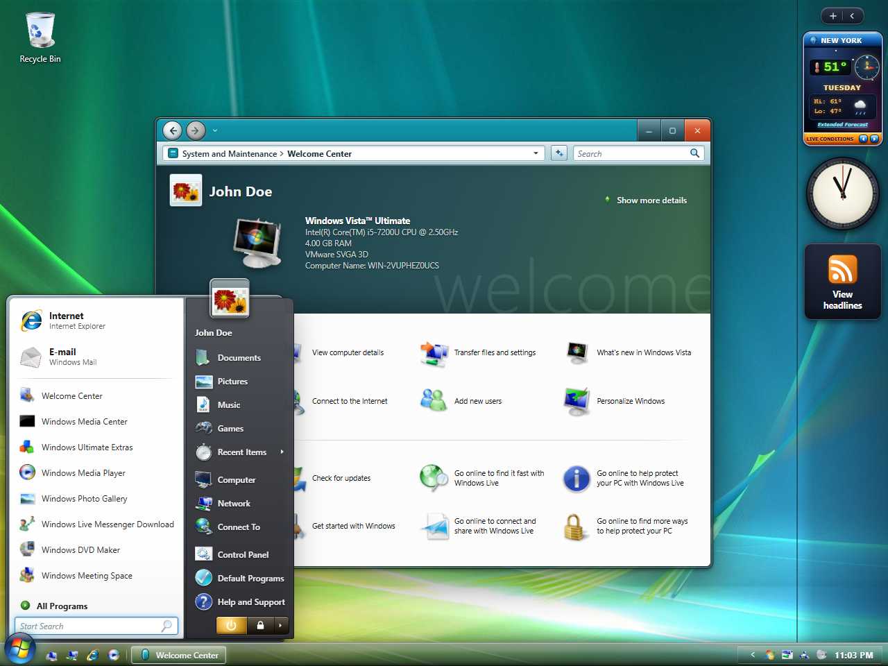
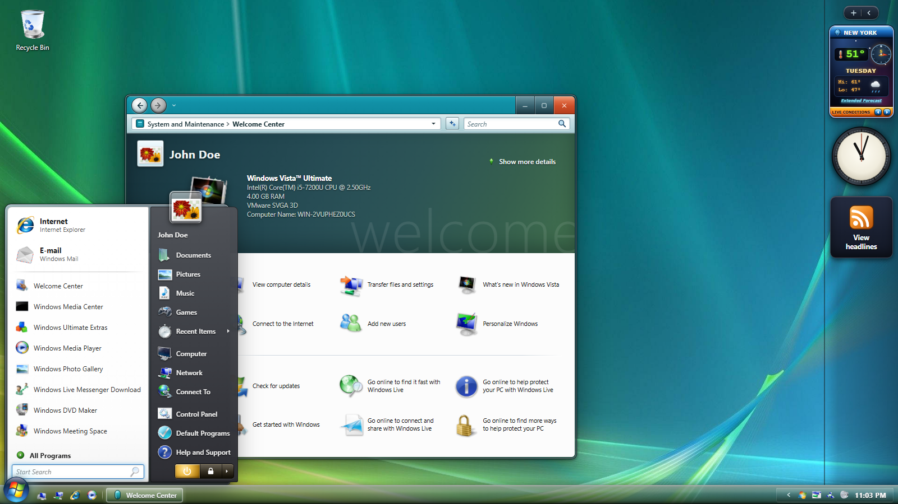

# Windows Vista — Desktop for the Web

A pixel-accurate, 1:1 recreation of the Windows Vista (Aero) desktop as a modern web app:
glass title bars, the pearl Start orb, the Start menu with live program filtering, the
Weather gadget with live US-city conditions, working Recycle Bin / Games / File Explorer windows, live RSS headlines, and more.




Reference screenshot: `e2e/reference-desktop.png` (640×480, the machine this app was
photographed from). `e2e/reference-1280.png` is the same image upscaled 2× with bicubic
sampling — the design grid was derived from it, and the Playwright visual regression test
compares against it. The wallpaper is `src/assets/wallpaper.jpg` (user-provided Aurora
render, 1920×1440); the original reference Aurora is kept at `src/assets/wallpaper-vista-reference.jpg`.

## Tech stack

- **Node.js** (current LTS) with **pnpm**
- **Vite 8** + **React 19** + **TypeScript 6** (strict mode; see _TypeScript version_ below)
- CSS Modules + CSS custom properties (`src/styles/tokens.css`) — every color, gradient,
  radius and shadow is a sampled design token. No UI component library; every control is
  custom-built.
- **Zustand** — window manager state (open windows, z-order, focus, minimized/maximized,
  Start menu open state).
- **Pointer Events** — custom `useDraggable` / `useResizable` hooks (no drag libraries).
- **Fastify** — small TypeScript server: serves the production build and proxies an RSS
  feed at `GET /api/feed` for the Sidebar "Feed headlines" gadget.
- **Vitest + React Testing Library** — unit tests (window manager, Start menu, feed fallback).
- **Playwright** — end-to-end tests incl. a visual regression test at 1280×960.

## Getting started

Requirements: Node.js ≥ 22.12 and pnpm (`npm install -g pnpm`).

```bash
pnpm install          # install dependencies

# development (two terminals)
pnpm dev              # Vite dev server on http://localhost:5173 (proxies /api -> :4173)
pnpm dev:server       # Fastify server on http://localhost:4173, watching server/

# production
pnpm build            # tsc -b && vite build  -> dist/
pnpm serve            # Fastify serves dist/ + /api/feed on :4173
# then open http://localhost:4173/
```

The front end **degrades gracefully** to baked-in sample headlines when `/api/feed` is
unavailable, so the site also deploys as a **pure static build** (`dist/` on any static
host — drop `vercel.json`/nginx config pointing at `dist/`, no server required).

`pnpm start` runs the same server via `node --import tsx server/server.ts`.

Environment variables for the server:

| Variable   | Default                                 | Purpose                       |
| ---------- | --------------------------------------- | ----------------------------- |
| `PORT`     | `4173`                                  | Listen port                   |
| `HOST`     | `0.0.0.0`                               | Listen host                   |
| `FEED_URL` | `https://feeds.bbci.co.uk/news/rss.xml` | RSS feed proxied by /api/feed |

Endpoints:

| Route              | Description                                                                                                                                                        |
| ------------------ | ------------------------------------------------------------------------------------------------------------------------------------------------------------------ |
| `GET /api/health`  | Liveness probe.                                                                                                                                                    |
| `GET /api/feed`    | RSS proxy for the Sidebar "Feed headlines" gadget (BBC News default). 5-minute cache.                                                                              |
| `GET /api/weather` | Current US-city conditions via [Open-Meteo](https://open-meteo.com) (no API key), 16 cities, 10-minute cache. Falls back to baked-in sample data when unreachable. |

## Quality gates

```bash
pnpm lint             # ESLint (flat config, strictTypeChecked)
pnpm format           # Prettier write;  pnpm format:check to verify
pnpm typecheck        # tsc -b (strict)
pnpm test             # Vitest + React Testing Library (26 tests)
pnpm test:e2e         # Playwright: builds, serves on :4173, runs 11 e2e tests
pnpm screenshots      # Playwright, visual-only
```

The visual regression test screenshots the desktop at 1280×960 with a frozen clock
(2007-10-30 23:03) and compares against `e2e/__screenshots__/desktop-4x3.png`, which is a
copy of the 2×-upscaled reference (`maxDiffPixelRatio: 0.2`, YIQ `threshold: 0.35`).
Both tolerances exist because the reference is a bicubic-upscaled 640×480 photo: sharp
ray edges in the original Aurora artwork cannot land on identical pixels, and the hand-
drawn icon artwork differs in detail from Vista's original bitmaps. The test's purpose is
layout/position regression, not pixel equality. To update the baseline after an intentional
visual change:

```bash
cp e2e/reference-1280.png e2e/__screenshots__/desktop-4x3.png   # or copy your new baseline
```

(Or delete the snapshot and run `pnpm exec playwright test --update-snapshots`.)

## Project structure

```
src/
  components/
    Desktop/        desktop, wallpaper, desktop icons (Recycle Bin, Games, File Explorer),
                    shutdown/lock overlays
    Taskbar/        Start orb, quick launch, taskbar buttons, system tray (live clock)
    StartMenu/      white pinned/program pane + dark glass right pane, avatar, live search,
                    Recent Items submenu, power/lock cluster with flyout
    Sidebar/        Sidebar strip + Weather gadget (live US-city conditions), RSS feed
                    headlines gadget (/api/feed)
    Window/         reusable glass window (drag, resize, minimize/maximize/close, z-order)
    WelcomeCenter/  the open window from the reference (John Doe, specs, link grid)
    Explorer/       Explorer shell (Recycle Bin and Games open empty folders; File Explorer
                    opens a populated Computer view with drives and user-folder tiles)
    ShellToolbar/   back/forward pearly circles, address bar with breadcrumb, search field
    icons/          spritemap.ts (name → tile) + Sheet.tsx renderer; a few SVG glyphs (orb,
                    caption buttons, RSS) and the sliced Vista tiles in src/assets/icons/
  hooks/            useNow, useDraggable, useResizable, useFeed
  store/            windowStore.ts (Zustand) + unit tests
  styles/           tokens.css (sampled Vista palette/geometry) + global.css
  assets/           wallpaper.jpg (Aurora, user-provided render, full-bleed cover)
                    wallpaper-vista-reference.jpg (original Microsoft Aurora, unused spare)
server/
  server.ts         Fastify: serves dist/, GET /api/feed RSS proxy (5-min cache, offline fallback)
e2e/                Playwright spec + reference images
```

## Features mapped to the reference

- **Start menu** (open on load, like the screenshot): pinned Internet/E-mail with
  subtitles, divider, full program list, "All Programs" with green arrow, Start Search
  with magnifier that **filters the program list live**, dark right pane with the orange
  flower avatar overlapping the top edge, John Doe,
  Documents/Pictures/Music/Games/Recent Items (with submenu), Computer, Network,
  Connect To, Control Panel, Default Programs, Help and Support, and the power/lock/flyout
  cluster (power = shutdown gag, lock = Vista lock-screen gag; click anywhere to wake).
- **Welcome Center window** (open on load): glass title bar with pearly back/forward
  circles, address bar `System and Maintenance > Welcome Center`, search field, red Close
  button with glow; teal header with the flower avatar, John Doe, monitor artwork,
  "Windows Vista™ Ultimate" and system specs, "Show more details" link with green diamond,
  and the large "welcome" watermark; white body with the full link grid (left column
  items fill in behind the Start menu, as in the reference).
- **Window management**: drag by title bar (pointer capture), resize from all edges and
  corners, minimize to the taskbar and restore (taskbar button toggles), maximize/restore
  (double-click the title bar too), close with red hover glow, click-to-focus z-ordering.
- **Sidebar**: dark glass strip with `+` and `<` gadget pill buttons, Weather gadget (a
  compact The Weather Channel "Current Conditions" broadcast graphic showing **live US city
  conditions** for New York, Chicago, LA, SF, Miami, Seattle, Las Vegas, New Orleans, Dallas,
  Atlanta, Boston, Washington DC, Denver, Phoenix, Houston and Orlando — a shiny deep-blue
  Aero-glass frame with cyan accents around a single chrome-framed glossy teal panel rotating
  every 6s through current temperature + condition icon, wind compass with direction needle,
  and today's Hi/Lo, "Live Conditions" ticker with `‹ ›` city cycling; auto-cycles cities
  every 6s), feed gadget (orange RSS icon labeled "RSS", expands to live BBC News headlines via
  `/api/feed`; static sample headlines when offline).
- **Taskbar**: glass bar, pearl Start orb with Windows flag (glows when the menu is
  open), quick launch (Show Desktop, Switch between windows, Internet Explorer, Windows
  Media Player), pressed "Welcome Center" taskbar button, system tray with live clock
  (`11:03 PM` format, real time) and tray glyphs.
- **Desktop**: Recycle Bin, Games and File Explorer icons with white shadowed labels;
  single-click selects with a translucent blue highlight, double-click opens the matching
  Explorer window. Recycle Bin and Games show the empty state + `0 objects`, while File
  Explorer opens a Vista **Computer** view with an `8 items` status bar: Local Disk (C:),
  DVD RW Drive (D:) and the Documents, Pictures, Music, Videos, Downloads and Games folders,
  all using real sliced Vista artwork.
- **Accessibility**: `role="menu"`/`menuitem`, `role="dialog"` windows, focus-visible
  rings, Escape closes the Start menu, arrow-key navigation between menu items, ARIA
  labels on all icon-only buttons.

Everything is anchored to screen edges (taskbar bottom, sidebar right, icons top-left),
so the desktop fills any browser window at any aspect ratio.

## TypeScript version

The project uses **TypeScript 6.0.3** rather than the brand-new 7.0.2: `typescript-eslint`
(<= 8.72.2, current stable) does not yet support the TypeScript 7 native compiler, and the
issue is tracked upstream. TS 6 is the latest stable JS-based release and keeps the whole
toolchain (Vite/Vitest/ESLint) on one coherent version. `strict: true` everywhere,
no `any`. When typescript-eslint ships TS 7 support, bump `typescript` back to latest.

## Icons

All application, tray and link icons are **real Vista artwork** sliced from a Vista-era
256-icon sprite sheet provided for this project (`vista256.jpg`), using `scripts/slice.mjs`:

- The sheet's 26×14 grid was detected from near-white separator runs in the image.
- Every cell was cut into `src/assets/icons/tile_RrCc.png` (348 tiles) and its white
  matte removed via a border flood-fill of near-white pixels (interior whites kept),
  with a 1px anti-alias feather.
- `src/components/icons/spritemap.ts` maps a semantic name → tile; `Sheet.tsx` renders it;
  `apps.tsx`, `system.tsx` and `shell.tsx` expose the same icon component API as before.
- Only a few glyphs remain hand-drawn SVG: the Start orb artwork, the white caption
  glyphs (min/max/close), the green "All Programs" arrow and the RSS gadget glyph.

To regenerate after replacing the sheet: `node scripts/slice.mjs path/to/vista256.jpg`.

## Remaining visual differences vs the reference

Pixel-for-pixel equality is impossible from a 640×480 photo (upscaled 2×), but layout,
geometry and palette were matched by measuring the reference pixel-by-pixel
(taskbar y-edges, window x/y/size, menu top/left/size, sidebar strip, taskbar height,
orange flower avatar position, watermark placement). Remaining deltas:

1. **Icon mapping** — the sliced artwork is a broad Vista-era icon set; some slots use a
   close thematic sibling (e.g. Photo Gallery is a landscape photo, Windows Media Player
   uses a circular play button) rather than their exact branded bitmaps.
2. **Welcome header "welcome" watermark** — matched in position/size/opacity but it is
   live text, not the blurred original.
3. **Wallpaper rays** — the reference screenshot's wallpaper is a bicubic-blurred
   downscale; this app renders the user-provided Aurora artwork, so sub-pixel ray edges differ.
4. **Fonts** — Segoe UI at ~12px Vista UI sizes; other machines fall back to Tahoma.
5. **Feed gadget** shows BBC News (live) by default collapsed to match the reference;
   click to expand headlines.
6. **Colors** — glass gradients take on the wallpaper hues beneath them, so tints vary
   slightly with resolution/scaling versus the fixed 640×480 original.

## Scripts cheat-sheet

| Command                | What it does                                      |
| ---------------------- | ------------------------------------------------- |
| `pnpm dev`             | Vite dev server (HMR) on :5173                    |
| `pnpm dev:server`      | Fastify API + static server (watch mode) on :4173 |
| `pnpm build`           | Type-check + production build to `dist/`          |
| `pnpm serve` / `start` | Serve the production build + API on :4173         |
| `pnpm lint`            | ESLint (flat config, strictTypeChecked)           |
| `pnpm format[:check]`  | Prettier write/check                              |
| `pnpm typecheck`       | `tsc -b`                                          |
| `pnpm test`            | Vitest unit tests                                 |
| `pnpm test:e2e`        | Playwright e2e + visual regression                |
